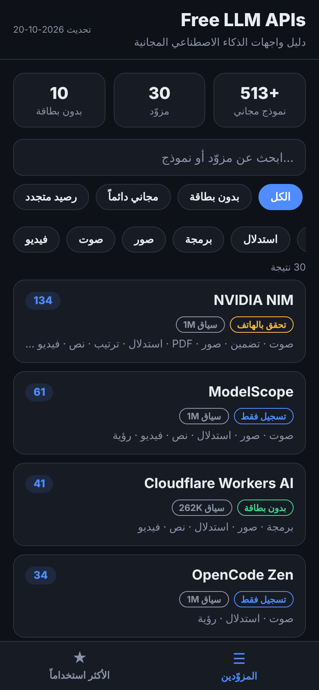
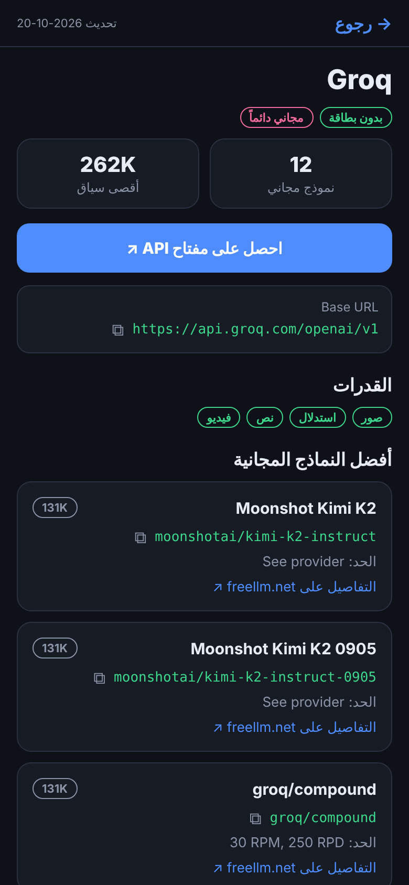
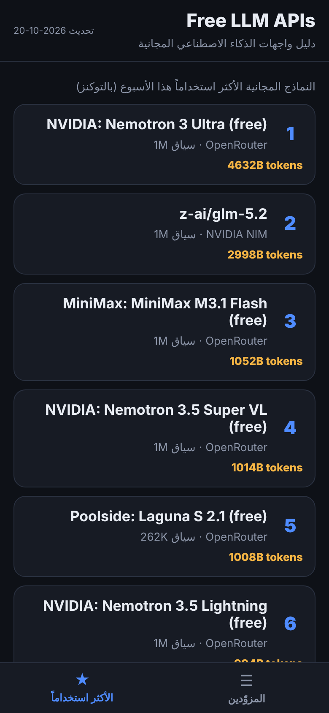

# Free LLM APIs — Mobile App

An Expo (React Native) app for browsing the free LLM API providers listed in this repository. Arabic, right-to-left interface, dark theme.

تطبيق موبايل لتصفّح واجهات الذكاء الاصطناعي المجانية الموجودة في هذا المستودع.

| Providers | Provider detail | Top models |
|---|---|---|
|  |  |  |

## Features

- 30 providers / 513+ free models, sorted by number of free models
- Search by provider name, model name or model ID
- Filters: no credit card, permanent free tier, renewable credits, and by capability (text, vision, reasoning, code, image, audio, video)
- Provider page: one-tap "Get API key" link, copyable base URL and model IDs, rate limits, and a ready-to-copy Python (OpenAI SDK) example
- Top models by weekly usage
- Works fully offline — data is bundled with the app

## Run it on your phone

1. Install **Expo Go** from Google Play or the App Store.
2. On a computer with Node.js 20+:
   ```bash
   cd mobile-app
   npm install
   npx expo start
   ```
3. Scan the QR code with Expo Go (Android) or the Camera app (iOS).

Preview in a browser: `npx expo start --web`.

## Build an installable APK / IPA

```bash
npx eas-cli@latest login
npx eas-cli@latest build -p android --profile preview   # APK
npx eas-cli@latest build -p ios                          # requires Apple developer account
```

## Updating the data

The data in `data/providers.json` is generated from the tables in the root `README.md`:

```bash
npm run build-data
```
